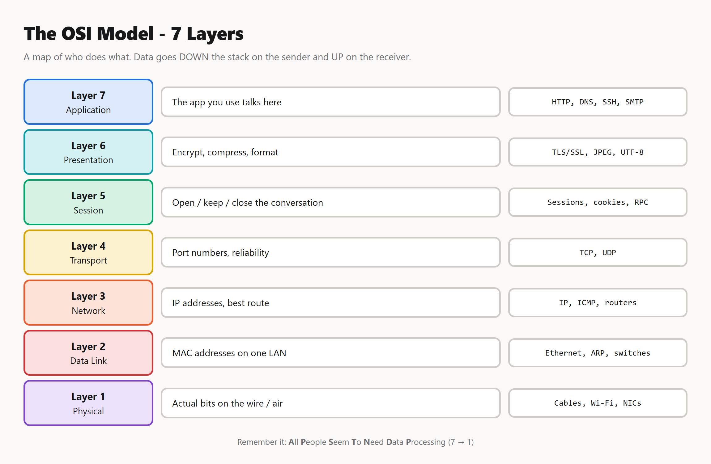
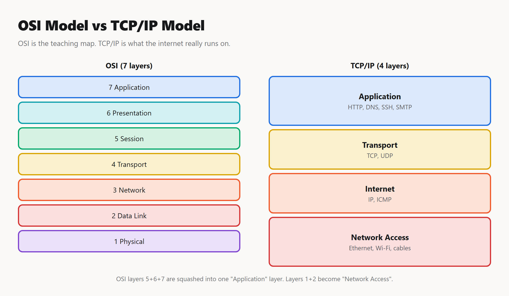
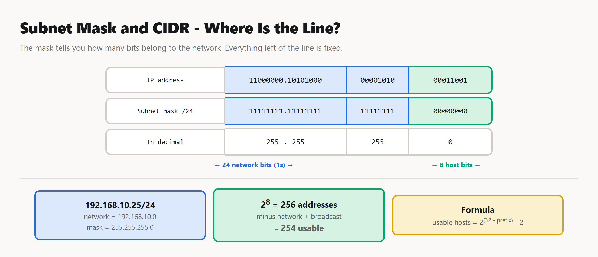
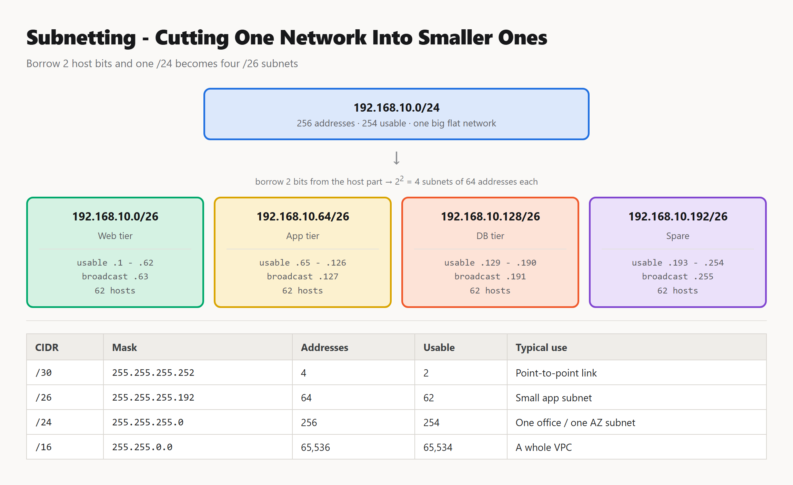
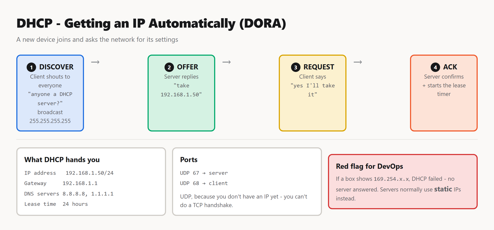
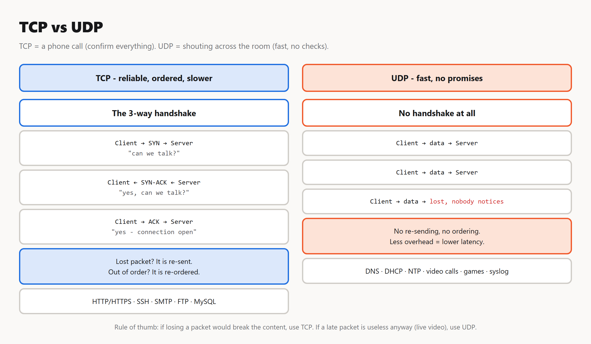
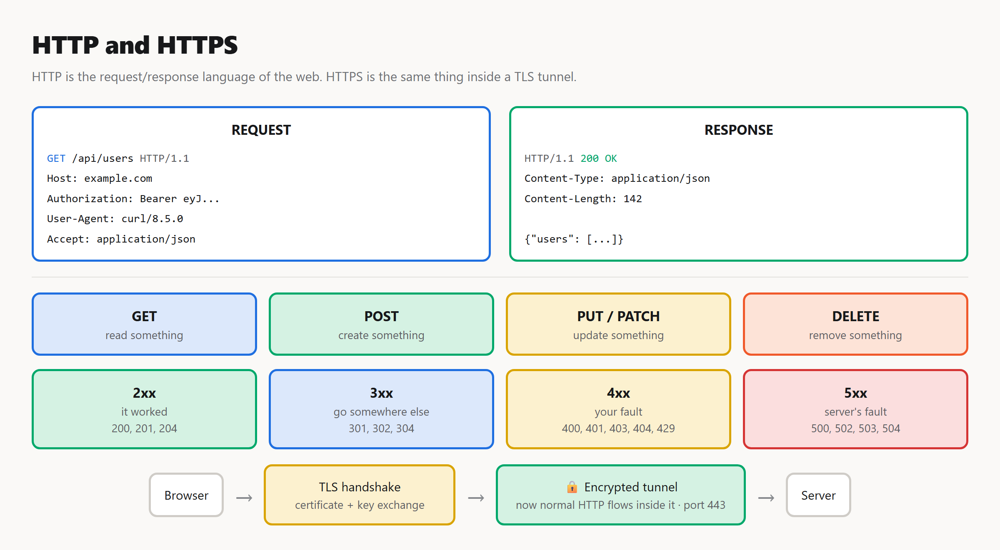
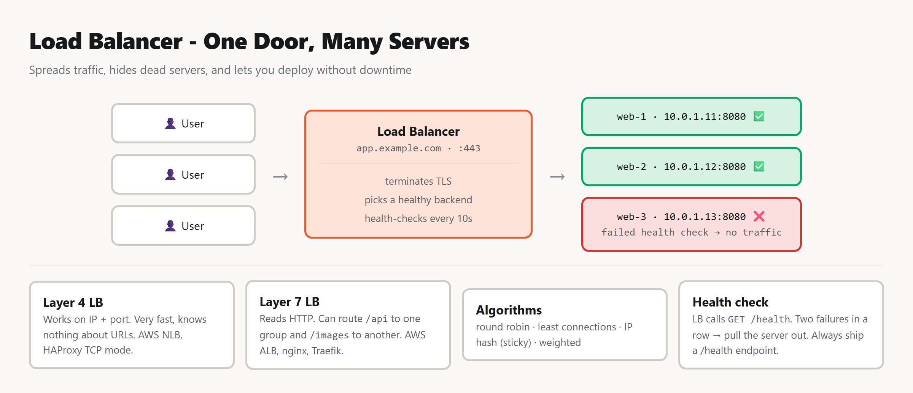
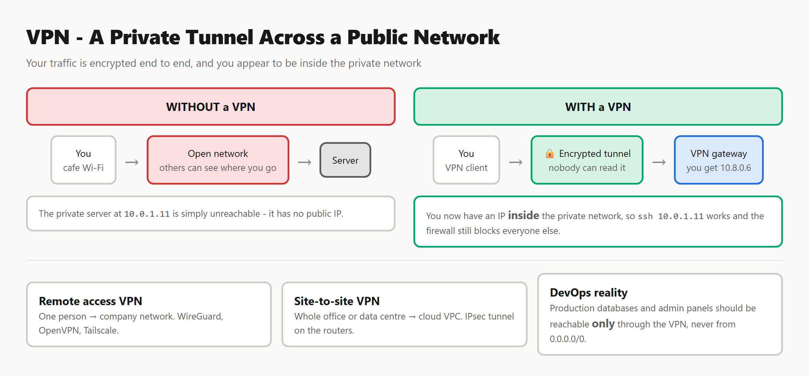
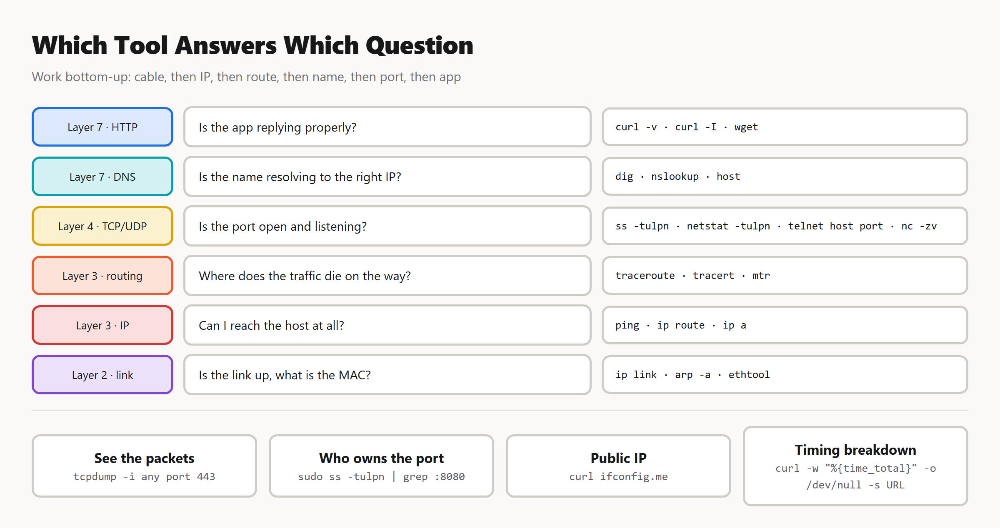

# 🌐 Networking Basics for DevOps

A simple, beginner-friendly guide to computer networking for DevOps: what each piece is, why DevOps people need it, and the exact commands you can run to see it with your own eyes.

Every topic follows the same pattern: **what it is**, **why DevOps people care**, and **something small you can try right now**. You don't need any networking background to start. Read it in order, run every command yourself, and finish with the labs at the end.


---

## 📚 Table of Contents

**PART 1: How Networks Actually Work**

1. [Start Here: Why Networking Matters for DevOps](#1-start-here-why-networking-matters-for-devops)
2. [The OSI Model](#2-the-osi-model)
3. [The TCP/IP Model](#3-the-tcpip-model)
4. [Encapsulation: How Data Gets Wrapped](#4-encapsulation-how-data-gets-wrapped)
5. [What Happens When You Open a Website](#5-what-happens-when-you-open-a-website)
6. [IP Addressing](#6-ip-addressing)
7. [Subnet Mask and CIDR](#7-subnet-mask-and-cidr)
8. [Subnetting Step by Step](#8-subnetting-step-by-step)
9. [Public vs Private IP](#9-public-vs-private-ip)
10. [NAT: Network Address Translation](#10-nat-network-address-translation)
11. [DHCP: Getting an IP Automatically](#11-dhcp-getting-an-ip-automatically)

**PART 2: Protocols (The Languages)**

12. [TCP vs UDP](#12-tcp-vs-udp)
13. [Ports and Sockets](#13-ports-and-sockets)
14. [DNS](#14-dns)
15. [HTTP and HTTPS](#15-http-and-https)
16. [SSH](#16-ssh)
17. [FTP, SFTP and File Transfer](#17-ftp-sftp-and-file-transfer)
18. [SMTP and Email](#18-smtp-and-email)

**PART 3: Network Infrastructure**

19. [Load Balancers](#19-load-balancers)
20. [Proxy and Reverse Proxy](#20-proxy-and-reverse-proxy)
21. [Firewalls and Security Groups](#21-firewalls-and-security-groups)
22. [VPN](#22-vpn)

**PART 4: Tools and Practice**

23. [The Networking Toolbox](#23-the-networking-toolbox)
24. [Troubleshooting Playbook](#24-troubleshooting-playbook)
25. [Practice Labs](#25-practice-labs)
26. [Cheat Sheet](#26-cheat-sheet)
27. [Reference](#27-reference)

---

# PART 1: How Networks Actually Work

---

## 1. Start Here: Why Networking Matters for DevOps

You can learn Docker, Kubernetes, Terraform and Jenkins, and still be stuck for hours on problems like these:

| What people say | What it actually is |
|-----------------|--------------------|
| "The deploy worked but the site shows 502" | The reverse proxy cannot reach the backend port |
| "It works on my laptop, not on the server" | The app is bound to `127.0.0.1` instead of `0.0.0.0` |
| "The new server cannot download packages" | Private subnet with no NAT gateway |
| "Our domain still points to the old server" | DNS TTL caching |
| "The pipeline times out talking to the database" | Security group does not allow port 3306 from that subnet |
| "SSH just hangs" | Firewall is dropping packets instead of rejecting them |

Every one of those is networking, not DevOps tooling. **Networking is the layer under everything you deploy.**

### 1.1 What you will be able to do after this guide

- Read an IP address and say which network it belongs to
- Split a network into subnets for a cloud VPC
- Explain why a site is slow, broken, or unreachable, **in the right order**
- Open exactly the ports you need and nothing else
- Debug DNS, TLS, proxies and load balancers with `dig`, `curl`, `ss` and `traceroute`

### 1.2 The 6 words you will see everywhere

| Word | Plain meaning |
|------|---------------|
| **Host** | Any machine on the network (laptop, server, phone, container) |
| **Packet** | A small chunk of your data with address labels attached |
| **Protocol** | Agreed rules for a conversation (HTTP, DNS, SSH…) |
| **Port** | A numbered door on a machine, one per program |
| **Gateway** | The way out of your network, normally your router |
| **Latency** | How long a packet takes to get there (measured in ms) |

> 💡 **Tip:** Keep a terminal open while you read. Every section has commands you can run immediately. Networking only makes sense when you watch it happen.

---

## 2. The OSI Model

**What it is:** A 7-layer map that splits "sending data" into small jobs, so people can say *where* a problem is instead of just "the network is broken".

**Why DevOps people care:** It gives you a search order. You never debug randomly - you go bottom-up (is the cable/IP alive?) or top-down (is the app replying?).



### 2.1 The layers, in human words

| # | Layer | Its one job | You meet it as |
|---|-------|-------------|----------------|
| 7 | **Application** | The thing the user actually uses | HTTP, DNS, SSH, SMTP |
| 6 | **Presentation** | Encrypt / compress / format the data | TLS certificates, UTF-8, JPEG |
| 5 | **Session** | Start, keep and close a conversation | Login sessions, cookies |
| 4 | **Transport** | Deliver to the right program, reliably or not | TCP, UDP, **port numbers** |
| 3 | **Network** | Find the best route between networks | **IP addresses**, routers, ICMP |
| 2 | **Data Link** | Move frames between two devices on the same LAN | MAC addresses, switches, ARP |
| 1 | **Physical** | Actual electricity, light or radio | Cables, Wi-Fi, network cards |

**Remember the order (7 → 1):** **A**ll **P**eople **S**eem **T**o **N**eed **D**ata **P**rocessing.

### 2.2 How to use it in real life

```
"The website is down"

Layer 1/2 → Is the machine online at all?          ip link, ip a
Layer 3   → Can I reach the IP?                    ping, traceroute
Layer 4   → Is the port open?                      nc -zv host 443
Layer 7   → Does the app answer correctly?         curl -v https://host
```

> 💡 **Tip:** In the real world people say "a layer 4 load balancer" (works on IP + port) and "a layer 7 load balancer" (reads HTTP). Now you know exactly what that means.

> ⚠️ **Warning:** Layers 5 and 6 barely exist in practice. Real traffic uses the TCP/IP model in the next section. Learn OSI for the vocabulary, use TCP/IP for the work.

---

## 3. The TCP/IP Model

**What it is:** The 4-layer model the internet is actually built on. Same idea as OSI, fewer boxes.



| TCP/IP layer | Swallows OSI layers | Examples |
|--------------|--------------------|----------|
| **Application** | 7 + 6 + 5 | HTTP, HTTPS, DNS, SSH, SMTP, FTP |
| **Transport** | 4 | TCP, UDP |
| **Internet** | 3 | IP, ICMP, routing |
| **Network Access** (Link) | 2 + 1 | Ethernet, Wi-Fi, ARP, cables |

### 3.1 Why two models exist

- **OSI** is the teaching model and the shared vocabulary ("that's a layer 3 problem").
- **TCP/IP** is the working model - it describes the protocols that really run.

### 3.2 The only comparison you need to remember

| Question | OSI | TCP/IP |
|----------|-----|--------|
| How many layers? | 7 | 4 |
| Who uses it? | Books, interviews, discussions | The actual internet |
| Is it a real implementation? | No, a reference | Yes |

> 💡 **Tip:** In an interview: *"OSI has 7 layers and is a reference model; TCP/IP has 4 layers and is what we actually run. OSI's session, presentation and application layers are merged into the TCP/IP application layer."*

---

## 4. Encapsulation: How Data Gets Wrapped

**What it is:** Each layer adds its own header to your data on the way down, and removes it on the way up. Like putting a letter inside an envelope, inside a parcel, inside a truck.


### 4.1 The names of the thing at each layer

| Layer | Name of the unit | What got added |
|-------|------------------|----------------|
| 7 Application | **Data** | Your actual content (`GET /index.html`) |
| 4 Transport | **Segment** (TCP) / **Datagram** (UDP) | Source port + destination port |
| 3 Network | **Packet** | Source IP + destination IP |
| 2 Data Link | **Frame** | Source MAC + destination MAC + error check |
| 1 Physical | **Bits** | Nothing - it is just signals now |

### 4.2 Why you should care

- A **packet capture** (`tcpdump`) shows you these exact headers. Once you know the layers, the output stops looking like noise.
- **MTU** (usually 1500 bytes) is the biggest frame a link can carry. Add a VPN or a tunnel and every packet carries extra headers, so the usable space shrinks. That is why VPNs sometimes break big requests but ping works fine.

```bash
# See the headers for yourself (Ctrl+C to stop)
sudo tcpdump -i any -n port 443
```

> ⚠️ **Warning:** "Ping works but the website hangs halfway" is the classic MTU problem. Ping is tiny; your HTTPS response is not.

---

## 5. What Happens When You Open a Website

This single picture ties the whole guide together. Everything you will read later is one of these steps.


### 5.1 The six steps

1. **DNS** - your computer asks "what is the IP of `example.com`?" and gets `93.184.216.34`. (Section 14)
2. **TCP handshake** - your computer and the server agree to talk, on port 443. (Section 12)
3. **TLS handshake** - they swap a certificate and keys, so everything after this is encrypted. (Section 15)
4. **HTTP request** - `GET / HTTP/1.1` plus headers goes up the tunnel. (Section 15)
5. **HTTP response** - `200 OK` comes back with HTML, then CSS, JS and images.
6. **Render** - the browser draws the page.

### 5.2 Watch it happen

```bash
# 1. DNS only
dig +short example.com
# 93.184.216.34

# 2-5. Everything, with the handshake and headers shown
curl -v https://example.com

# How long each stage took
curl -w "dns:%{time_namelookup}s connect:%{time_connect}s tls:%{time_appconnect}s total:%{time_total}s\n" \
     -o /dev/null -s https://example.com
```

Example output:

```
dns:0.021s connect:0.145s tls:0.302s total:0.418s
```

Now you can answer "why is the site slow?" with a number instead of a guess: slow DNS, slow connect (network/distance), slow TLS, or slow server.

> 💡 **Tip:** `curl -w` is the single most useful performance command in this guide. Save it as an alias.

---

## 6. IP Addressing

**What it is:** An IP address is the "postal address" of a machine on a network.


### 6.1 IPv4 in one line

An IPv4 address is **4 numbers (octets), each 0-255**, which is really **32 bits**:

```
192.168.10.25
 │   │   │  └── octet 4 → 00011001
 │   │   └───── octet 3 → 00001010
 │   └───────── octet 2 → 10101000
 └───────────── octet 1 → 11000000
```

### 6.2 Network part and host part

Every address is split in two:

- The **network part** says *which network* (like the street name)
- The **host part** says *which machine on it* (like the house number)

Where the split happens is decided by the **subnet mask** (next section). Two machines can talk directly only if their network part is identical.

### 6.3 Three addresses you cannot give to a machine

| Address in `192.168.10.0/24` | Meaning |
|------------------------------|---------|
| `192.168.10.0` | The network itself |
| `192.168.10.255` | Broadcast - "everyone on this network" |
| `192.168.10.1` | Not reserved, but it is almost always the **gateway** (router) |

So a `/24` has 256 addresses but only **254 usable**.

### 6.4 See your own

```bash
ip a                      # Linux: all addresses
ip route                  # Linux: your gateway ("default via ...")
ipconfig                  # Windows
ifconfig                  # Mac / older Linux
hostname -I               # Linux: just the IPs
curl ifconfig.me          # your PUBLIC IP (see section 9)
```

Typical Linux output:

```
2: eth0: <BROADCAST,MULTICAST,UP,LOWER_UP> mtu 1500
    inet 192.168.1.25/24 brd 192.168.1.255 scope global dynamic eth0
```

Read it as: *my IP is `192.168.1.25`, my network is `192.168.1.0/24`, broadcast is `192.168.1.255`, and the address was given by DHCP (`dynamic`).*

### 6.5 What about IPv6?

IPv4 has about 4.3 billion addresses - not enough for the world, which is why NAT exists. IPv6 uses **128 bits** and looks like this:

```
2606:2800:220:1:248:1893:25c8:1946
fe80::1                             # :: means "a run of zeros"
::1                                 # loopback, the IPv6 version of 127.0.0.1
```

You rarely subnet IPv6 by hand, but you will see `AAAA` DNS records and `fe80::` link-local addresses on every Linux box.

> 💡 **Tip:** `127.0.0.1` (and the name `localhost`) always means *this machine*. Nothing leaves the computer. If your app only listens there, nobody else can reach it - that is one of the most common beginner bugs.

---

## 7. Subnet Mask and CIDR

**What it is:** The mask is the line that separates the network part from the host part.



### 7.1 Two ways to write the same thing

| CIDR | Subnet mask | Network bits | Host bits |
|------|-------------|--------------|-----------|
| `/24` | `255.255.255.0` | 24 | 8 |
| `/16` | `255.255.0.0` | 16 | 16 |
| `/8` | `255.0.0.0` | 8 | 24 |

`192.168.10.25/24` and `192.168.10.25 255.255.255.0` are **identical**. CIDR (`/24`) is just shorter, and it is what every cloud console asks for.

### 7.2 The only formula you need

```
usable hosts = 2 ^ (32 - prefix) - 2
```

The `- 2` removes the network address and the broadcast address.

| CIDR | Mask | Total addresses | Usable hosts |
|------|------|-----------------|--------------|
| `/30` | 255.255.255.252 | 4 | **2** |
| `/29` | 255.255.255.248 | 8 | **6** |
| `/28` | 255.255.255.240 | 16 | **14** |
| `/27` | 255.255.255.224 | 32 | **30** |
| `/26` | 255.255.255.192 | 64 | **62** |
| `/25` | 255.255.255.128 | 128 | **126** |
| `/24` | 255.255.255.0 | 256 | **254** |
| `/23` | 255.255.254.0 | 512 | **510** |
| `/22` | 255.255.252.0 | 1,024 | **1,022** |
| `/16` | 255.255.0.0 | 65,536 | **65,534** |
| `/8` | 255.0.0.0 | 16,777,216 | **16,777,214** |

**Smaller number = bigger network.** `/16` is huge, `/30` is tiny.

### 7.3 Two shortcuts worth memorising

- `/32` = exactly **one** address. You will use it constantly in firewall rules: `203.0.113.5/32` means "only this one IP".
- `0.0.0.0/0` = **every** address on the internet. "Allow from `0.0.0.0/0`" means "allow from anybody". Be careful with it.

### 7.4 Check it with a command

```bash
# Install if needed: sudo apt install ipcalc
ipcalc 192.168.10.25/26
```

```
Address:   192.168.10.25
Netmask:   255.255.255.192 = 26
Network:   192.168.10.0/26
HostMin:   192.168.10.1
HostMax:   192.168.10.62
Broadcast: 192.168.10.63
Hosts/Net: 62
```

> 💡 **Tip:** Nobody memorises masks. Memorise the **formula** and the three common ones (`/24`, `/16`, `/32`), then use `ipcalc`.

---

## 8. Subnetting Step by Step

**What it is:** Cutting one network into several smaller ones.

**Why DevOps people care:** Every cloud VPC is subnetted. Public subnets hold the load balancer, private subnets hold the app and database. Get it wrong and you either cannot reach your servers or you expose your database to the internet.



### 8.1 The method (4 steps)

Goal: split `192.168.10.0/24` into **4 subnets**.

**Step 1 - how many bits to borrow?**
`2^n >= 4` → `n = 2`. Borrow 2 bits from the host part.

**Step 2 - new prefix**
`/24 + 2 = /26` → mask `255.255.255.192`

**Step 3 - block size**
`256 - 192 = 64`. Each subnet holds 64 addresses, so networks start every 64: `0, 64, 128, 192`.

**Step 4 - write them out**

| # | Network | Usable range | Broadcast | Hosts |
|---|---------|--------------|-----------|-------|
| 1 | `192.168.10.0/26` | .1 - .62 | .63 | 62 |
| 2 | `192.168.10.64/26` | .65 - .126 | .127 | 62 |
| 3 | `192.168.10.128/26` | .129 - .190 | .191 | 62 |
| 4 | `192.168.10.192/26` | .193 - .254 | .255 | 62 |

### 8.2 A real cloud example

A VPC of `10.0.0.0/16` (65,536 addresses) across 2 availability zones:

| Subnet | CIDR | What lives there |
|--------|------|------------------|
| Public  AZ-a | `10.0.1.0/24` | Load balancer, NAT gateway, bastion |
| Public  AZ-b | `10.0.2.0/24` | Load balancer |
| Private AZ-a | `10.0.11.0/24` | App servers / pods |
| Private AZ-b | `10.0.12.0/24` | App servers / pods |
| Data    AZ-a | `10.0.21.0/24` | Database |
| Data    AZ-b | `10.0.22.0/24` | Database replica |

> ⚠️ **Warning:** Cloud providers steal some addresses from every subnet. AWS reserves **5** per subnet (network, VPC router, DNS, future use, broadcast), so a `/24` gives you **251** usable addresses, not 254.

> 💡 **Tip:** Leave gaps (`.1`, `.2`, then `.11`, `.12`) so you can add subnets later without renumbering. Never pick `10.0.0.0/16` for one small project if the company might later connect networks together - overlapping CIDRs are painful to fix.

### 8.3 Practice (answers below)

1. How many usable hosts in `10.0.5.0/27`?
2. Which subnet does `172.16.4.130/25` belong to?
3. Split `192.168.1.0/24` into 8 subnets - what is the new prefix?

<details>
<summary>Show answers</summary>

1. `2^(32-27) - 2 = 30` usable hosts.
2. `/25` block size is 128, so networks are `.0` and `.128`. `130` falls in **`172.16.4.128/25`** (range .129 - .254, broadcast .255).
3. `2^3 = 8`, so borrow 3 bits: `/24 + 3 =` **`/27`** (block size 32: .0, .32, .64, .96, .128, .160, .192, .224).

</details>

---

## 9. Public vs Private IP

**What it is:** Private IPs are free, reusable addresses for inside your own network. Public IPs are globally unique and reachable from the internet.


### 9.1 The private ranges (RFC 1918) - memorise these

| Range | CIDR | Size | Where you see it |
|-------|------|------|------------------|
| `10.0.0.0` - `10.255.255.255` | `10.0.0.0/8` | 16.7M | Cloud VPCs, big companies |
| `172.16.0.0` - `172.31.255.255` | `172.16.0.0/12` | 1M | Docker default (`172.17.0.0/16`) |
| `192.168.0.0` - `192.168.255.255` | `192.168.0.0/16` | 65K | Home and office routers |

### 9.2 Special addresses

| Address | Meaning |
|---------|---------|
| `127.0.0.1` | Loopback = this machine (`localhost`) |
| `0.0.0.0` | "All interfaces" when a server binds; "any address" in a route |
| `169.254.x.x` | Link-local / APIPA - **DHCP failed**, no real IP was given |
| `169.254.169.254` | Cloud metadata service (AWS/Azure/GCP instance info) |
| `255.255.255.255` | Broadcast to everyone on this network |

### 9.3 Why this matters every day

```bash
ip a | grep inet          # 192.168.1.25  → private, inside your network
curl ifconfig.me          # 203.0.113.7   → public, what the world sees
```

If both commands show the **same** address, your machine has a real public IP (common on cloud servers). If they differ, you are behind **NAT** (next section).

> ⚠️ **Warning:** A private IP is not security. Anything inside the same network can still reach it. Firewalls and security groups are what protect you (Section 21).

> 💡 **Tip:** Interview question: *"Can two companies both use 192.168.1.10?"* Yes - private addresses are never routed on the internet, so they can be reused everywhere. The only problem is when you connect two such networks together (VPN) and the ranges overlap.

---

## 10. NAT: Network Address Translation

**What it is:** The router rewrites private source addresses into one public address, and keeps a table so replies find their way home.

**Why DevOps people care:** NAT is why your 20 home devices share one IP, and why private cloud servers need a **NAT gateway** to install packages while staying unreachable from outside.


### 10.1 What the router does

```
Laptop sends:   192.168.1.10:54321 → 93.184.216.34:443
Router rewrites: 203.0.113.7:40001 → 93.184.216.34:443   and remembers the mapping
Reply comes to:  93.184.216.34:443 → 203.0.113.7:40001
Router rewrites: 93.184.216.34:443 → 192.168.1.10:54321  ✅ back to your laptop
```

### 10.2 The two types you will meet

| Type | Direction | Real example |
|------|-----------|--------------|
| **SNAT / PAT / Masquerade** | Inside → out | Home router; AWS NAT gateway letting private subnets run `apt update` |
| **DNAT / Port forwarding** | Outside → in | Public `:8080` forwarded to `192.168.1.10:80`; a Kubernetes `NodePort` |

### 10.3 In the cloud

| Setup | Can reach the internet? | Reachable from the internet? |
|-------|------------------------|------------------------------|
| Public subnet + public IP | ✅ yes | ✅ yes (if the firewall allows) |
| Private subnet + NAT gateway | ✅ yes (outbound only) | ❌ no |
| Private subnet, no NAT | ❌ no | ❌ no |

That middle row is the normal, safe place for application and database servers.

> ⚠️ **Warning:** "My server in the private subnet cannot `apt update`" is nearly always a missing NAT gateway or a missing route to it. Check the route table before blaming DNS.

> 💡 **Tip:** NAT breaks the idea that every host is directly reachable. That is why VoIP, peer-to-peer and some game protocols need extra tricks (STUN/TURN) - and why incoming connections need explicit port forwarding.

---

## 11. DHCP: Getting an IP Automatically

**What it is:** A server that hands out IP addresses and network settings to any device that joins.



### 11.1 DORA - the 4 steps

| Step | Who talks | Message |
|------|-----------|---------|
| **D**iscover | Client (broadcast) | "Is there a DHCP server out there?" |
| **O**ffer | Server | "Yes - take `192.168.1.50`" |
| **R**equest | Client | "I accept that one" |
| **A**cknowledge | Server | "Confirmed, the lease lasts 24 hours" |

It runs over **UDP ports 67 (server) and 68 (client)** - UDP, because the client has no IP yet and cannot do a TCP handshake.

### 11.2 What you receive

```
IP address   192.168.1.50/24
Gateway      192.168.1.1
DNS servers  8.8.8.8, 1.1.1.1
Lease time   86400 seconds
```

### 11.3 Commands

```bash
# Linux
sudo dhclient -r && sudo dhclient     # release and renew
cat /var/lib/dhcp/dhclient.leases     # see the current lease

# Windows
ipconfig /release
ipconfig /renew
```

### 11.4 Static vs dynamic

| | DHCP (dynamic) | Static |
|---|---|---|
| Laptops, phones, containers | ✅ | |
| Servers, routers, printers, databases | | ✅ |
| Why | Zero admin work | The address must never change |

In the cloud you get the best of both: the instance uses DHCP, but the subnet always gives it the **same** private IP for its lifetime.

> ⚠️ **Warning:** An address starting `169.254.` means DHCP got **no answer**. Check that the DHCP server is up, the interface is really connected, and that nothing is blocking UDP 67/68.
---

# PART 2: Protocols (The Languages)

---

## 12. TCP vs UDP

**What it is:** Two ways to deliver data. TCP checks everything arrived; UDP just fires it off.



### 12.1 Side by side

| | TCP | UDP |
|---|-----|-----|
| Connection first? | Yes - 3-way handshake | No |
| Lost packet | Re-sent automatically | Gone forever |
| Order | Guaranteed | Not guaranteed |
| Speed | Slower (more checks) | Faster |
| Overhead per packet | 20+ bytes | 8 bytes |
| Analogy | A phone call | Shouting across a room |
| Used by | HTTP(S), SSH, SMTP, FTP, MySQL | DNS, DHCP, NTP, video calls, games, syslog |

### 12.2 The TCP 3-way handshake

```
Client ──────── SYN ────────▶ Server     "can we talk?"
Client ◀────── SYN-ACK ────── Server     "yes, can we talk?"
Client ──────── ACK ────────▶ Server     "yes" → connection established
```

And to close it: `FIN` → `ACK` → `FIN` → `ACK`.

Watch a real one:

```bash
sudo tcpdump -i any -n "tcp port 443 and host example.com"
curl -s https://example.com > /dev/null     # in another terminal
```

### 12.3 Why this explains your error messages

| What you see | What it means at TCP level |
|--------------|---------------------------|
| **Connection refused** | The SYN arrived, but nothing is listening on that port → the service is down or on another port |
| **Connection timed out** | The SYN got no answer at all → a firewall is **dropping** packets, or the host is unreachable |
| **Connection reset by peer** | The other side sent `RST` and killed the connection mid-flight |

That difference between *refused* and *timed out* saves hours. Refused = service problem. Timeout = firewall/routing problem.

### 12.4 When to pick UDP

Pick UDP when a late packet is worthless anyway: live video, voice, metrics, logs, game state. Pick TCP whenever losing a byte would corrupt the result: web pages, files, databases.

> 💡 **Tip:** HTTP/3 runs on **QUIC**, which is built on UDP - but it re-implements reliability itself. So "web = TCP" is true for HTTP/1.1 and HTTP/2, and no longer strictly true for HTTP/3.

---

## 13. Ports and Sockets

**What it is:** The IP finds the **machine**; the port finds the **program** on that machine.


### 13.1 The three ranges

| Range | Name | Notes |
|-------|------|-------|
| 0 - 1023 | Well-known | Need root/admin to bind (22, 80, 443…) |
| 1024 - 49151 | Registered | Apps and databases (3306, 5432, 8080…) |
| 49152 - 65535 | Ephemeral | The random **source** port your client uses |

A **socket** is the pair `IP:port`. A connection is really four things: `source IP:port → destination IP:port`.

### 13.2 The ports every DevOps engineer should know by heart

| Port | Protocol | Use |
|------|----------|-----|
| 20 / 21 | FTP | Old file transfer (plain text) |
| 22 | SSH / SFTP / SCP | Remote login and secure copy |
| 25 | SMTP | Server-to-server mail (usually blocked in cloud) |
| 53 | DNS | Name lookups (UDP, TCP for large answers) |
| 67 / 68 | DHCP | Automatic IP configuration |
| 80 | HTTP | Web, not encrypted |
| 110 / 995 | POP3 / POP3S | Download mail |
| 143 / 993 | IMAP / IMAPS | Read mail on the server |
| 389 / 636 | LDAP / LDAPS | Directory and logins |
| 443 | HTTPS | Web over TLS |
| 587 / 465 | SMTP submission | Apps sending mail |
| 3306 | MySQL | Database |
| 3389 | RDP | Windows remote desktop |
| 5432 | PostgreSQL | Database |
| 6379 | Redis | Cache |
| 8080 / 3000 / 5000 | HTTP alternatives | Dev servers, apps behind a proxy |
| 9090 / 9100 | Prometheus / node exporter | Metrics |
| 27017 | MongoDB | Database |

### 13.3 Seeing what is listening

```bash
ss -tulpn                 # modern Linux: TCP, UDP, listening, process, numeric
netstat -tulpn            # older systems, same idea
sudo lsof -i :8080        # which process owns port 8080
```

```
Netid  State   Local Address:Port   Process
tcp    LISTEN  0.0.0.0:443          users:(("nginx",pid=812))
tcp    LISTEN  127.0.0.1:3306       users:(("mysqld",pid=640))
```

Read it carefully:

- `0.0.0.0:443` = listening on **all** interfaces → reachable from outside ✅
- `127.0.0.1:3306` = listening on **localhost only** → nothing outside this machine can connect ❌

### 13.4 Testing a port from another machine

```bash
nc -zv example.com 443           # best: tells you open / refused / timeout
telnet example.com 443           # old but everywhere
curl -v telnet://example.com:443 # when nc and telnet are missing
```

> ⚠️ **Warning:** "It works locally but not from the load balancer" is usually a `127.0.0.1` bind. Change the app to listen on `0.0.0.0` (or the specific private IP) and check again with `ss -tulpn`.

> 💡 **Tip:** Ports below 1024 need root. That is why containers and apps usually listen on 8080 and let nginx or the load balancer own 80/443.

---

## 14. DNS

**What it is:** The system that turns names into IP addresses.

**Why DevOps people care:** More outages are caused by DNS than anyone admits - wrong record, cached TTL, wrong resolver, expired domain.


### 14.1 How a lookup works

1. Browser cache → 2. OS cache → 3. `/etc/hosts` → 4. **Resolver** (your ISP, `8.8.8.8`, `1.1.1.1`)
5. Resolver asks a **root** server → "ask `.com`"
6. Asks the **TLD** server → "ask `ns1.example.com`"
7. Asks the **authoritative** server → "`93.184.216.34`"
8. Answer is cached at every step for **TTL** seconds.

### 14.2 Record types

| Record | Does what | Example |
|--------|-----------|---------|
| `A` | Name → IPv4 | `example.com → 93.184.216.34` |
| `AAAA` | Name → IPv6 | `example.com → 2606:2800::1` |
| `CNAME` | Alias to another name | `www → example.com` |
| `MX` | Where email goes | `10 mail.example.com` |
| `TXT` | Free text: SPF, DKIM, domain verification | `"v=spf1 include:..."` |
| `NS` | Which servers are authoritative | `ns1.example.com` |
| `PTR` | IP → name (reverse) | `34.216.184.93.in-addr.arpa` |
| `SRV` | Service location (port + host) | Used by Kubernetes, SIP, AD |

### 14.3 The commands

```bash
dig example.com                    # full answer with TTL and sections
dig +short example.com             # just the IP - use this 90% of the time
dig MX example.com                 # a specific record type
dig @8.8.8.8 example.com           # ask one specific resolver
dig +trace example.com             # follow root → TLD → authoritative yourself
dig -x 93.184.216.34               # reverse lookup

nslookup example.com               # works on Windows too
host example.com                   # short and simple

cat /etc/resolv.conf               # which resolver your Linux box uses
resolvectl status                  # systemd machines
ipconfig /displaydns               # Windows: see the cache
ipconfig /flushdns                 # Windows: clear it
```

### 14.4 Reading `dig` output

```
;; ANSWER SECTION:
example.com.        3600    IN    A     93.184.216.34
                     │             │      └── the answer
                     │             └── record type
                     └── TTL: cached for 3600 seconds (1 hour)
```

### 14.5 The classic DNS traps

| Symptom | Cause | Fix |
|---------|-------|-----|
| Old IP still answering after a migration | TTL caching | Lower the TTL to 60s **before** the change, raise it after |
| Works on one machine, not another | Different resolvers, or a stale `/etc/hosts` entry | `dig @8.8.8.8` vs `dig` and compare |
| `curl` fails but `ping` works | Different name, or IPv6 (`AAAA`) record that is broken | `dig A` and `dig AAAA` separately |
| Site dies suddenly for everyone | Domain or certificate expired | Check the registrar, then `curl -vI` |

> 💡 **Tip:** `/etc/hosts` (or `C:\Windows\System32\drivers\etc\hosts`) beats DNS. It is the fastest way to test a new server before you move the real record:
> ```
> 203.0.113.50   app.example.com
> ```

> ⚠️ **Warning:** A `CNAME` cannot sit at the root of a domain (`example.com` itself) in standard DNS. Use an `A` record, or your provider's special "ALIAS" / "ANAME" record.

---

## 15. HTTP and HTTPS

**What it is:** HTTP is the request/response language of the web. HTTPS is exactly the same language inside a TLS-encrypted tunnel on port 443.



### 15.1 A request and a response

```http
GET /api/users HTTP/1.1
Host: example.com
Authorization: Bearer eyJhbGciOi...
User-Agent: curl/8.5.0
Accept: application/json
```

```http
HTTP/1.1 200 OK
Content-Type: application/json
Content-Length: 142
Cache-Control: max-age=60

{"users": [...]}
```

### 15.2 Methods

| Method | Means | Changes data? |
|--------|-------|---------------|
| `GET` | Read something | No |
| `POST` | Create something | Yes |
| `PUT` | Replace something | Yes |
| `PATCH` | Update part of something | Yes |
| `DELETE` | Remove something | Yes |
| `HEAD` | Like GET but headers only | No |

### 15.3 Status codes - what to check first

| Code | Meaning | Where to look |
|------|---------|---------------|
| `200 OK` | Fine | - |
| `301 / 302` | Moved | Redirect loop? Check your proxy rules |
| `304 Not Modified` | Use your cache | Normal |
| `400` | Bad request | The client sent nonsense |
| `401` | Not authenticated | Missing or expired token |
| `403` | Authenticated but not allowed | Permissions, WAF, S3 policy |
| `404` | Not found | Wrong path or wrong virtual host |
| `429` | Too many requests | Rate limiting |
| `500` | Server crashed | **Application logs** |
| `502 Bad Gateway` | Proxy reached but backend did not answer | **Backend is down or on the wrong port** |
| `503 Service Unavailable` | No healthy backend / overloaded | Health checks, scaling |
| `504 Gateway Timeout` | Backend was too slow | Timeouts, slow queries |

> 💡 **Tip:** `4xx` = the client's fault. `5xx` = the server's fault. `502/503/504` always point at the **gap between the proxy and the backend** - start there, not in the browser.

### 15.4 HTTPS and TLS in one minute

1. Client says hello and lists the ciphers it supports.
2. Server sends its **certificate** (proving it owns the domain).
3. They agree on a session key.
4. Everything after that is encrypted. 🔒

```bash
# Look at a certificate: who issued it, when it expires
echo | openssl s_client -connect example.com:443 -servername example.com 2>/dev/null \
  | openssl x509 -noout -subject -issuer -dates

# Headers only
curl -I https://example.com

# Full handshake + headers
curl -v https://example.com
```

| TLS error you will meet | Real cause |
|-------------------------|------------|
| `certificate has expired` | Nobody renewed it (automate with certbot / ACM) |
| `self signed certificate` | Internal CA not trusted by the client |
| `hostname mismatch` | Certificate is for `www.example.com`, you asked for `example.com` |
| `unable to get local issuer certificate` | Missing intermediate certificate in the chain |

### 15.5 Useful curl flags

```bash
curl -I URL                       # headers only
curl -L URL                       # follow redirects
curl -k URL                       # ignore certificate errors (debug only!)
curl -X POST -d '{"a":1}' -H "Content-Type: application/json" URL
curl -o file.zip URL              # save to a file
curl -s -o /dev/null -w "%{http_code}\n" URL    # print just the status code
curl --resolve app.example.com:443:203.0.113.50 https://app.example.com
```

That last one is gold: it tests a **new server** using the real hostname and certificate, without touching DNS.

---

## 16. SSH

**What it is:** Encrypted remote login and file copy, on **port 22**.


### 16.1 Keys, not passwords

```bash
ssh-keygen -t ed25519 -C "you@example.com"     # creates ~/.ssh/id_ed25519(.pub)
ssh-copy-id user@10.0.1.5                      # copies the PUBLIC key to the server
ssh user@10.0.1.5                              # log in, no password
```

- `id_ed25519` = **private** key. Never leaves your laptop, never goes in Git.
- `id_ed25519.pub` = **public** key. Goes into the server's `~/.ssh/authorized_keys`.

### 16.2 Everyday commands

```bash
ssh -i ~/.ssh/aws.pem ec2-user@203.0.113.9     # specific key file
ssh -p 2222 user@host                          # non-default port
ssh user@host "df -h"                          # run one command and exit
scp report.txt user@host:/tmp/                 # copy a file up
scp user@host:/var/log/app.log .               # copy a file down
rsync -avz ./site/ user@host:/var/www/site/    # copy only what changed
sftp user@host                                 # interactive file session
```

### 16.3 SSH tunnels (how you reach a locked-down service)

```bash
# Local forward: my localhost:8080 → the server's localhost:80
ssh -L 8080:localhost:80 user@bastion

# Reach a private database through a bastion host
ssh -L 5432:db.internal:5432 user@bastion
# then: psql -h localhost -p 5432
```

This is how you open a private admin panel or database that has no public IP at all.

### 16.4 `~/.ssh/config` - stop typing long commands

```
Host prod
    HostName 203.0.113.9
    User ec2-user
    IdentityFile ~/.ssh/aws.pem
    Port 22

Host db
    HostName 10.0.21.10
    User admin
    ProxyJump prod          # hop through the bastion automatically
```

Now `ssh prod` and `ssh db` just work.

### 16.5 Hardening (`/etc/ssh/sshd_config`)

```
PermitRootLogin no
PasswordAuthentication no
PubkeyAuthentication yes
```

```bash
sudo systemctl restart sshd
```

Plus: allow port 22 **only** from your office or VPN range in the firewall.

> ⚠️ **Warning:** `chmod 600 ~/.ssh/id_ed25519` - SSH refuses keys that other users can read. And if you ever commit a private key or a `.pem` to Git, treat it as compromised and rotate it.

> 💡 **Tip:** `ssh -v user@host` shows exactly where the login fails: TCP connect, key offered, or permission. Read the first failure, not the last line.

---

## 17. FTP, SFTP and File Transfer


| Protocol | Port | Encrypted? | Use it? |
|----------|------|-----------|---------|
| **FTP** | 21 (+20 data) | ❌ No - password in plain text | ❌ Avoid |
| **FTPS** | 990 / 21 + TLS | ✅ Yes | Only for legacy systems |
| **SFTP** | 22 | ✅ Yes (over SSH) | ✅ **Default choice** |
| **SCP** | 22 | ✅ Yes (over SSH) | ✅ Quick one-off copies |
| **rsync over SSH** | 22 | ✅ Yes | ✅ Best for backups and big folders |

```bash
sftp user@host                     # interactive: put, get, ls, cd
scp -r ./dist user@host:/var/www/  # recursive copy
rsync -avz --delete ./dist/ user@host:/var/www/dist/   # mirror a folder
```

**Active vs passive FTP** (why FTP annoys firewalls): in *active* mode the **server** opens a second connection back to the client, which NAT and firewalls block. *Passive* mode lets the client open both connections, so it mostly works - but it needs a whole port range open. SFTP needs one port: 22. That is the whole argument.

> 💡 **Tip:** `rsync -avz --dry-run` first. It shows exactly what would be copied or deleted, and has saved many people from wiping a production folder.

---

## 18. SMTP and Email

| Protocol | Port | Job |
|----------|------|-----|
| **SMTP** | 25 | Server → server delivery (cloud providers usually block 25) |
| **SMTP submission** | 587 (STARTTLS) or 465 (TLS) | Your app → mail server |
| **IMAP** | 143 / 993 | Read mail, stays on the server, syncs across devices |
| **POP3** | 110 / 995 | Download mail, usually deletes the server copy |

### 18.1 Why DevOps engineers care

Alerting, password resets and CI notifications all go through SMTP. When mail stops arriving, check in this order:

1. **Egress** - can the server reach port 587? `nc -zv smtp.provider.com 587`
2. **MX record** - `dig MX example.com`
3. **SPF / DKIM / DMARC** - `dig TXT example.com` (missing records = silently sent to spam)
4. **Credentials and logs** - `/var/log/mail.log`

```bash
# Test that the SMTP port is reachable at all
nc -zv smtp.gmail.com 587

# Send a test mail from a server
echo "test body" | mail -s "test subject" you@example.com
```

> ⚠️ **Warning:** AWS, GCP and Azure block outbound port **25** by default to stop spam. Use a mail provider (SES, SendGrid, Mailgun) on port 587 or 465 instead of running your own relay.
---

# PART 3: Network Infrastructure

---

## 19. Load Balancers

**What it is:** One public entry point that spreads traffic across many servers and skips the unhealthy ones.

**Why DevOps people care:** It is what makes "deploy with no downtime" and "scale out" possible.



### 19.1 What it actually gives you

| Benefit | How |
|---------|-----|
| No single point of failure | A dead server fails its health check and gets no traffic |
| Scale out | Add servers behind the same address |
| Zero-downtime deploys | Drain one server, update it, put it back, repeat |
| TLS termination | Certificates live on the LB, backends speak plain HTTP |
| One DNS name | `app.example.com` never changes, servers come and go |

### 19.2 Layer 4 vs Layer 7

| | Layer 4 (transport) | Layer 7 (application) |
|---|---|---|
| Decides using | IP + port | URL, host header, cookies |
| Can route `/api` separately? | ❌ No | ✅ Yes |
| Speed | Very fast | Slightly slower |
| Examples | AWS NLB, HAProxy TCP mode | AWS ALB, nginx, Traefik, Envoy |

### 19.3 Algorithms

| Algorithm | How it picks |
|-----------|--------------|
| **Round robin** | Next server in the list, in turn |
| **Least connections** | The server with the fewest open connections |
| **IP hash / sticky** | The same client always lands on the same server (for in-memory sessions) |
| **Weighted** | Bigger servers get more traffic |

### 19.4 Health checks - the part people get wrong

```
GET /health  every 10s
healthy threshold:   2 successes  → put it back in
unhealthy threshold: 2 failures   → take it out
timeout: 5s
```

Your app should expose a real `/health` endpoint that checks its own dependencies and returns `200` or `503`.

```bash
# Is the LB sending me traffic? Check from the LB's point of view:
curl -s -o /dev/null -w "%{http_code}\n" http://10.0.1.11:8080/health
```

> ⚠️ **Warning:** A `503` from the load balancer with no backend logs means **no healthy targets**. Check the health check path, port and the security group between the LB and the instances - in that order.

> 💡 **Tip:** Sticky sessions are a crutch. Store sessions in Redis or a database and any server can serve any user - that is what makes autoscaling painless.

---

## 20. Proxy and Reverse Proxy

**What it is:** A middleman. The only difference is *whose* side it sits on.


| | Forward proxy | Reverse proxy |
|---|---|---|
| Sits in front of | **Clients** | **Servers** |
| Hides | The client from the server | The server from the client |
| Who configures it | The user / the company laptop | The infrastructure team |
| Typical use | Web filtering, caching downloads, controlled egress | TLS, load balancing, caching, rate limiting |
| Examples | Squid, corporate proxy, `HTTP_PROXY` env var | nginx, Traefik, HAProxy, Cloudflare, ALB |

### 20.1 Forward proxy in daily life

```bash
export HTTP_PROXY=http://proxy.company.com:3128
export HTTPS_PROXY=http://proxy.company.com:3128
export NO_PROXY=localhost,127.0.0.1,.internal
curl https://example.com        # now goes through the proxy
```

If `apt`, `docker pull` or `pip` fail behind a corporate network, those three variables (plus Docker's own proxy config) are usually the fix.

### 20.2 Reverse proxy - the config you will write a hundred times

```nginx
server {
    listen 443 ssl;
    server_name app.example.com;

    ssl_certificate     /etc/letsencrypt/live/app.example.com/fullchain.pem;
    ssl_certificate_key /etc/letsencrypt/live/app.example.com/privkey.pem;

    location / {
        proxy_pass http://127.0.0.1:3000;
        proxy_set_header Host              $host;
        proxy_set_header X-Real-IP         $remote_addr;
        proxy_set_header X-Forwarded-For   $proxy_add_x_forwarded_for;
        proxy_set_header X-Forwarded-Proto $scheme;
    }

    location /api/ {
        proxy_pass http://127.0.0.1:5000/;
    }
}
```

```bash
sudo nginx -t              # ALWAYS test before reloading
sudo systemctl reload nginx
```

Those `X-Forwarded-*` headers matter: without them your application logs every request as coming from the proxy, and redirects break by sending users to `http://` instead of `https://`.

> 💡 **Tip:** A load balancer *is* a reverse proxy whose main job is spreading traffic. nginx, Traefik and Envoy do both jobs at once - the words overlap, and that is fine.

> ⚠️ **Warning:** `502 Bad Gateway` from nginx = nginx is alive but the backend is not answering on `proxy_pass`. Check the backend is running, on the right port, and listening on an address nginx can reach.

---

## 21. Firewalls and Security Groups

**What it is:** Rules that decide which traffic is allowed in or out. The golden rule is **default deny**: block everything, then open exactly what you need.


### 21.1 A sane rule set for a web server

| # | Direction | Port | Source | Action | Why |
|---|-----------|------|--------|--------|-----|
| 1 | Inbound | 443 | `0.0.0.0/0` | ALLOW | The public website |
| 2 | Inbound | 80 | `0.0.0.0/0` | ALLOW | Only to redirect to HTTPS |
| 3 | Inbound | 22 | `203.0.113.5/32` | ALLOW | SSH from the office/VPN only |
| 4 | Inbound | 3306 | `10.0.1.0/24` | ALLOW | MySQL from the app subnet only |
| 5 | Inbound | ANY | `0.0.0.0/0` | **DENY** | The implicit rule at the bottom |

### 21.2 Stateful vs stateless

- **Stateful** (security groups, `ufw`, `firewalld`): allow a connection in, and the reply is automatically allowed back out. You only write one rule.
- **Stateless** (AWS NACLs, plain `iptables` without conntrack): you must allow the return traffic too - including the ephemeral port range `1024-65535`.

### 21.3 Cloud wording

| Provider | Instance level | Subnet level |
|----------|----------------|--------------|
| AWS | Security group (stateful, allow-only) | NACL (stateless, allow + deny) |
| Azure | NSG | NSG on the subnet |
| GCP | Firewall rules (by tag) | VPC firewall rules |

### 21.4 Commands

```bash
# ufw (Ubuntu)
sudo ufw default deny incoming
sudo ufw default allow outgoing
sudo ufw allow 443/tcp
sudo ufw allow from 203.0.113.5 to any port 22 proto tcp
sudo ufw enable
sudo ufw status numbered

# firewalld (RHEL / Fedora)
sudo firewall-cmd --permanent --add-service=https
sudo firewall-cmd --permanent --add-port=8080/tcp
sudo firewall-cmd --reload
sudo firewall-cmd --list-all

# iptables (the low level under both)
sudo iptables -L -n -v
```

### 21.5 How a firewall feels from the outside

| Behaviour | What the firewall did |
|-----------|----------------------|
| `Connection refused` **immediately** | Packet got through; nothing is listening (or the rule REJECTs) |
| **Hangs, then timeout** | The packet was silently **DROPped** - classic firewall block |

```bash
nc -zv app.example.com 443        # succeeded / refused / timed out
```

> ⚠️ **Warning:** Never leave SSH (22) open to `0.0.0.0/0` on a production server. Bots find it within minutes. Restrict it to your IP, a bastion, or a VPN.

> 💡 **Tip:** Before you enable a firewall on a remote machine, make sure the SSH rule is in place - otherwise you lock yourself out of your own server. Open a second SSH session as a safety net while you test.

---

## 22. VPN

**What it is:** An encrypted tunnel across a public network, which also gives you an IP **inside** the private network.



### 22.1 The two types

| Type | Connects | Used for |
|------|----------|----------|
| **Remote access** | One person → company network | Engineers reaching private servers from home |
| **Site-to-site** | Whole office/data centre → cloud VPC | Hybrid infrastructure, permanent IPsec tunnel |

### 22.2 What it changes

| Without VPN | With VPN |
|-------------|----------|
| Private server `10.0.21.10` is unreachable | You get `10.8.0.6` and can `ssh 10.0.21.10` |
| Anyone on the café Wi-Fi sees your traffic metadata | Encrypted end to end |
| Admin panels need public exposure | Admin panels stay private - VPN only |

### 22.3 Tools you will meet

| Tool | Note |
|------|------|
| **WireGuard** | Modern, fast, tiny config. Current default choice |
| **OpenVPN** | Older, very compatible, heavier |
| **IPsec / IKEv2** | Standard for site-to-site between routers and clouds |
| **Tailscale / ZeroTier** | WireGuard with the hard parts (keys, NAT traversal) done for you |

```bash
# WireGuard
sudo wg-quick up wg0
sudo wg show                 # peers, handshakes, transfer
sudo wg-quick down wg0

# Prove you are inside the private network
ip a | grep wg0
ping 10.0.21.10
```

> 💡 **Tip:** The safest production pattern: **no public IPs on app or database servers**. Only the load balancer is public; humans get in through a VPN or a bastion host. If someone asks you to open a database port to `0.0.0.0/0`, suggest the VPN instead.

> ⚠️ **Warning:** If your home network is `192.168.1.0/24` and the office VPN is also `192.168.1.0/24`, routing breaks in confusing ways. That is why companies pick unusual ranges like `10.42.0.0/16`.
---

# PART 4: Tools and Practice

---

## 23. The Networking Toolbox

Every tool answers one question at one layer. Learn which question each one answers and troubleshooting becomes mechanical.



### 23.1 `ping` - can I reach the host at all?

```bash
ping example.com            # Linux/Mac: runs until Ctrl+C
ping -c 4 example.com       # stop after 4
ping -n 4 example.com       # Windows
```

```
64 bytes from 93.184.216.34: icmp_seq=1 ttl=56 time=12.4 ms
--- 4 packets transmitted, 4 received, 0% packet loss
rtt min/avg/max/mdev = 12.1/12.6/13.2/0.4 ms
```

| What you read | What it tells you |
|---------------|-------------------|
| `time=12.4 ms` | Latency. Same city ~1-20ms, another continent ~150-300ms |
| `0% packet loss` | Healthy. Any loss above 0% on a wired link is a problem |
| `ttl=56` | Hops left before the packet dies - roughly how far away it is |
| `Request timeout` | Host down, **or** ICMP is simply blocked (very common in clouds) |

> ⚠️ **Warning:** "Ping fails" does **not** mean "the server is down". Many clouds block ICMP by default. Always confirm with `nc -zv host port` before declaring an outage.

### 23.2 `traceroute` / `tracert` / `mtr` - where does it break?

```bash
traceroute example.com         # Linux/Mac
traceroute -T -p 443 host      # use TCP instead of UDP (gets through more firewalls)
tracert example.com            # Windows
mtr example.com                # live, continuously updating - the best of the three
```

```
1  192.168.1.1      1.2 ms      ← your router
2  10.20.30.1      11.8 ms      ← your ISP
3  * * *                        ← this hop hides itself (often fine)
8  93.184.216.34   12.4 ms      ← destination
```

Read it as: latency should climb gradually. A jump from 12ms to 300ms at one hop shows you where the slowness starts. `* * *` at a single hop is usually just a router that ignores traceroute; `* * *` all the way to the end means the path really is broken.

### 23.3 `dig` / `nslookup` - is the name right?

```bash
dig +short app.example.com        # the answer, nothing else
dig app.example.com               # with TTL and sections
dig @1.1.1.1 app.example.com      # ask a specific resolver
dig +trace app.example.com        # full path from the root servers
dig -x 93.184.216.34              # reverse lookup
nslookup app.example.com          # the Windows-friendly option
```

### 23.4 `curl` - is the application answering?

```bash
curl -I https://example.com                      # headers only
curl -v https://example.com                      # handshake + headers + body
curl -L https://example.com                      # follow redirects
curl -s -o /dev/null -w "%{http_code}\n" URL     # just the status code
curl -w "dns:%{time_namelookup} tls:%{time_appconnect} total:%{time_total}\n" -o /dev/null -s URL
curl --resolve app.example.com:443:203.0.113.50 https://app.example.com   # test a server before DNS
curl -x http://proxy:3128 https://example.com    # through a proxy
```

### 23.5 `wget` - download files and mirror sites

```bash
wget https://example.com/file.tar.gz
wget -c https://example.com/big.iso          # continue a broken download
wget -q --spider https://example.com && echo UP    # just check it is alive
wget -r -l 2 https://example.com             # recursive download (be polite)
```

| | `curl` | `wget` |
|---|---|---|
| Best at | APIs, headers, debugging | Downloading files, retries, recursion |
| Output | stdout by default | A file by default |
| In scripts | Health checks, API calls | Fetching artifacts |

### 23.6 `ss` and `netstat` - what is listening here?

```bash
ss -tulpn                  # TCP+UDP listening, with process names
ss -tan                    # all TCP sockets and their states
ss -tn state established   # current established connections
ss -s                      # summary counts

netstat -tulpn             # older equivalent
netstat -an | findstr LISTENING    # Windows
```

TCP states you will see: `LISTEN` (waiting), `ESTABLISHED` (connected), `TIME_WAIT` (recently closed - harmless in small numbers), `SYN_SENT` (handshake never answered → firewall).

### 23.7 `telnet` and `nc` - is the port open?

```bash
nc -zv example.com 443            # preferred
nc -zv -w 3 10.0.1.11 3306        # with a 3 second timeout
telnet example.com 443            # old but available everywhere
```

```
Connection to example.com 443 port [tcp/https] succeeded!   ✅ open
nc: connect to ... Connection refused                        ❌ nothing listening
nc: connect to ... Operation timed out                       🔥 firewall dropping
```

You can even speak HTTP by hand:

```bash
telnet example.com 80
GET / HTTP/1.1
Host: example.com
          ← press Enter twice
```

### 23.8 `ip` - addresses, routes and links

```bash
ip a                  # addresses
ip link               # interfaces up/down
ip route              # routing table, including "default via" (your gateway)
ip neigh              # ARP table: IP → MAC on this LAN
```

### 23.9 `tcpdump` - see the actual packets

```bash
sudo tcpdump -i any -n port 443
sudo tcpdump -i any -n host 10.0.1.11
sudo tcpdump -i any -n port 53                 # watch DNS queries live
sudo tcpdump -i any -n -w capture.pcap         # save for Wireshark
```

Use it when every other tool says "should be fine" and it still is not.

### 23.10 One-line reference

| Tool | Answers |
|------|---------|
| `ping` | Is the host reachable, and how far away? |
| `traceroute` / `mtr` | Where on the path does it break or slow down? |
| `dig` / `nslookup` | Does the name resolve, and to what? |
| `curl` | Does the application reply, with what status and timing? |
| `wget` | Can I download this file? |
| `ss` / `netstat` | What is listening on this machine, and to whom? |
| `nc` / `telnet` | Is that port open from here? |
| `ip` / `ifconfig` | What are my addresses, routes and gateway? |
| `tcpdump` | What is actually on the wire? |

---

## 24. Troubleshooting Playbook


### 24.1 "The site is down" - run these in order

```bash
# 1. Does the name resolve, and to the IP you expect?
dig +short app.example.com

# 2. Is the host reachable? (ICMP may be blocked - don't panic yet)
ping -c 3 203.0.113.50
traceroute 203.0.113.50

# 3. Is the port open from here?
nc -zv app.example.com 443

# 4. On the server: is the app really listening, and on which address?
ss -tulpn | grep -E ':(80|443|8080)'

# 5. What does HTTP say?
curl -v https://app.example.com
```

### 24.2 Symptom → likely cause

| Symptom | Most likely cause | Check |
|---------|------------------|-------|
| `NXDOMAIN` / "could not resolve host" | DNS record missing or typo'd | `dig`, `/etc/resolv.conf` |
| Resolves to the **old** IP | TTL cache | `dig @8.8.8.8`, lower TTL |
| `Connection refused` | Service down or wrong port | `ss -tulpn`, `systemctl status` |
| `Connection timed out` | Firewall / security group dropping | Firewall rules, routes |
| Works locally, not remotely | App bound to `127.0.0.1` | `ss -tulpn` → change to `0.0.0.0` |
| `502 Bad Gateway` | Backend down or wrong `proxy_pass` port | Backend logs, `curl localhost:3000` |
| `503 Service Unavailable` | No healthy LB targets | Health check path/port, SG between LB and app |
| `504 Gateway Timeout` | Backend too slow | App timeouts, slow queries |
| TLS certificate error | Expired, wrong name, missing chain | `openssl s_client` |
| Private server cannot `apt update` | Missing NAT gateway or route | Route table, NAT gateway |
| Works on IPv4, breaks sometimes | Broken `AAAA` record | `dig AAAA`, `curl -4` |
| Intermittent slowness | Packet loss on the path | `mtr` for a few minutes |

### 24.3 The two habits that matter

1. **Change one thing at a time.** Then re-test. Three simultaneous changes make the cause unfindable.
2. **Prove each layer before moving up.** Name → host → port → application. Do not debug HTTP headers when the port is closed.

> 💡 **Tip:** Write down what you tested and what the result was while you work. When you hand it to a colleague or write the incident report, you already have the timeline.

---

## 25. Practice Labs

Reading is not learning. Do these on your laptop or a free cloud VM.


### Lab 1: Map your own network (15 minutes)

```bash
ip a                        # your private IP and mask
ip route                    # your gateway
cat /etc/resolv.conf        # your DNS resolver
curl ifconfig.me            # your public IP
traceroute google.com       # the path out
```

**Write down:** your IP and CIDR, the network address, the broadcast address, how many usable hosts your network has, and how many hops to Google.

### Lab 2: Subnet a VPC on paper (20 minutes)

Split `10.0.0.0/16` for 3 availability zones with one public and one private subnet each (6 subnets). Give each a `/24`. Write the network, usable range and broadcast for every one. Check yourself with `ipcalc`.

### Lab 3: Break and fix DNS on purpose (15 minutes)

```bash
sudo sh -c 'echo "127.0.0.1 example.com" >> /etc/hosts'
curl -I http://example.com      # now fails or hits your own machine
dig +short example.com          # dig ignores /etc/hosts - still the real IP!
```

That difference between `dig` and `curl` is the lesson. Then remove the line you added.

### Lab 4: Reverse proxy two apps (45 minutes)

```bash
mkdir app && echo "<h1>APP</h1>" > app/index.html && (cd app && python3 -m http.server 3000 &)
mkdir api && echo '{"ok":true}'  > api/index.html && (cd api && python3 -m http.server 5000 &)
```

Install nginx, route `/` → `:3000` and `/api/` → `:5000`, then `curl localhost/` and `curl localhost/api/`. Stop the app on 3000 and watch nginx return **502** - that is the error you will meet in production.

### Lab 5: Lock a server down (30 minutes)

On a cloud VM: default deny, allow 443 from anywhere, allow 22 **only** from your current IP (`curl ifconfig.me`). Test from a phone hotspot - SSH should time out, HTTPS should work. Keep a second SSH session open while you do this.

### Lab 6: Debug a dead port (20 minutes)

```bash
python3 -m http.server 8000 --bind 127.0.0.1     # bound to localhost only
```

From another machine: `nc -zv SERVER_IP 8000` → refused/timeout. Prove why with `ss -tulpn | grep 8000`, then restart with `--bind 0.0.0.0` and test again.

### Lab 7: Read a TLS certificate (10 minutes)

```bash
echo | openssl s_client -connect github.com:443 -servername github.com 2>/dev/null \
  | openssl x509 -noout -subject -issuer -dates
```

Who issued it, which names it covers, and when it expires. Now you can check an "is the certificate expired?" incident in 10 seconds.

### Lab 8: Watch DNS traffic live (10 minutes)

```bash
sudo tcpdump -i any -n port 53        # terminal 1
dig github.com                        # terminal 2
```

You will see the query leave and the answer come back - DNS stops being magic.

---

## 26. Cheat Sheet

```bash
# ───── Identity ─────────────────────────────────────────────
ip a / ipconfig              # my addresses
ip route                     # my gateway
curl ifconfig.me             # my public IP
hostname -I                  # just the IPs

# ───── Name resolution ──────────────────────────────────────
dig +short host              # name → IP
dig MX|TXT|NS domain         # other records
dig @8.8.8.8 host            # ask a specific resolver
nslookup host                # Windows-friendly

# ───── Reachability ─────────────────────────────────────────
ping -c 4 host               # is it alive (if ICMP allowed)
traceroute host              # path and where it breaks
mtr host                     # live traceroute + loss

# ───── Ports ────────────────────────────────────────────────
nc -zv host 443              # is the port open from here
ss -tulpn                    # what is listening locally
sudo lsof -i :8080           # who owns this port

# ───── HTTP ─────────────────────────────────────────────────
curl -I url                  # headers
curl -v url                  # full conversation
curl -s -o /dev/null -w "%{http_code}\n" url
curl --resolve host:443:IP https://host      # test before DNS cutover

# ───── TLS ──────────────────────────────────────────────────
echo | openssl s_client -connect host:443 -servername host 2>/dev/null \
  | openssl x509 -noout -subject -issuer -dates

# ───── Packets ──────────────────────────────────────────────
sudo tcpdump -i any -n port 443
```

### Numbers worth memorising

| Thing | Value |
|-------|-------|
| Private ranges | `10.0.0.0/8`, `172.16.0.0/12`, `192.168.0.0/16` |
| Usable hosts | `2^(32 - prefix) - 2` |
| `/24` | 254 usable &nbsp;·&nbsp; `/26` → 62 &nbsp;·&nbsp; `/30` → 2 |
| Loopback | `127.0.0.1` |
| "Everything" | `0.0.0.0/0` &nbsp;·&nbsp; "one host" → `/32` |
| DHCP failed | `169.254.x.x` |
| Core ports | 22 SSH · 53 DNS · 80 HTTP · 443 HTTPS · 3306 MySQL · 5432 Postgres · 6379 Redis |
| Refused vs timeout | Refused = service problem · Timeout = firewall problem |

---

## 27. Reference

- 📘 [Cloudflare Learning Center](https://www.cloudflare.com/learning/) - the clearest free explanations of DNS, TLS, proxies and CDNs
- 📘 [Beej's Guide to Network Programming](https://beej.us/guide/bgnet/) - how sockets really work
- 📘 [High Performance Browser Networking](https://hpbn.co/) - free book, excellent on TCP, TLS and HTTP/2
- 🔧 [ipcalc online](https://jodies.de/ipcalc) - subnet calculator
- 🔧 [MDN HTTP docs](https://developer.mozilla.org/en-US/docs/Web/HTTP) - methods, headers, status codes
- 🔧 [curl cheat sheet](https://curl.se/docs/manpage.html) - every flag explained
- 🔧 [dig HOWTO](https://www.isc.org/bind/) - BIND and DNS tooling
- 🔒 [SSL Labs server test](https://www.ssllabs.com/ssltest/) - grade your TLS setup
- 🔒 [Mozilla SSL Config Generator](https://ssl-config.mozilla.org/) - nginx/Apache TLS config that is actually correct
- ☁️ [AWS VPC docs](https://docs.aws.amazon.com/vpc/latest/userguide/what-is-amazon-vpc.html) - subnets, route tables, NAT, security groups
- ☸️ [Kubernetes networking](https://kubernetes.io/docs/concepts/services-networking/) - services, DNS and ingress
- 🦈 [Wireshark](https://www.wireshark.org/) - when `tcpdump` output needs a UI

> 💡 **Tip:** Learn by doing. Run every command in this guide on a real machine, break something on purpose, then fix it. That is the only way networking sticks.

⭐ If this guide helped you, give the repo a star!
